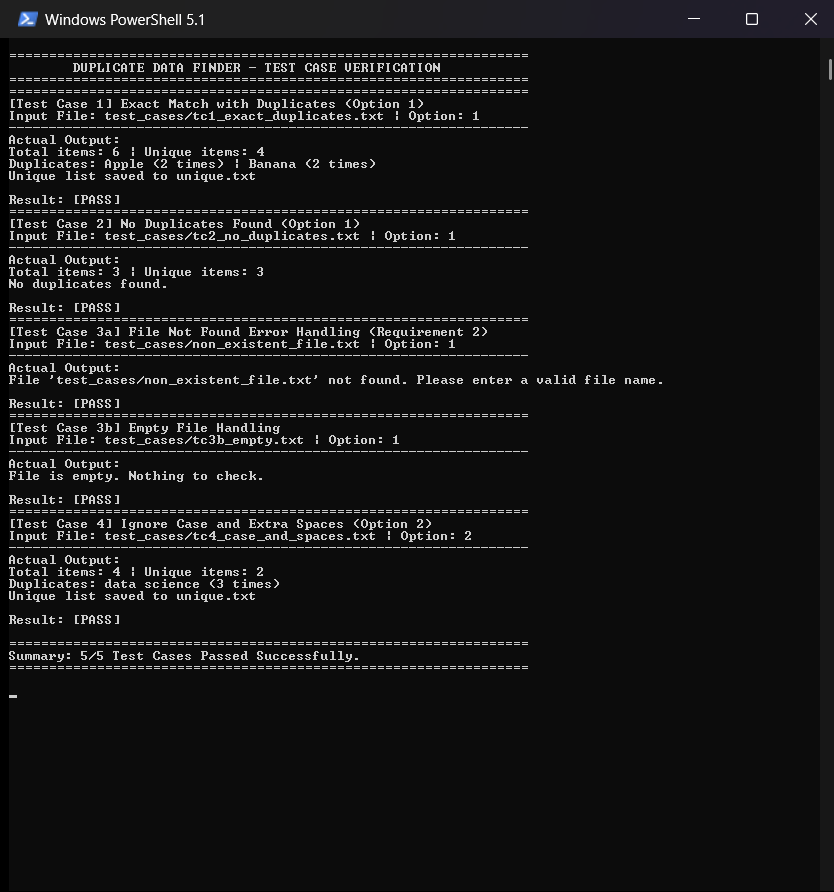

# Duplicate Data Finder

A Python tool that finds duplicate entries in a text file, counts their occurrences, and saves the unique entries to an output file.

The tool supports two modes:
1. **Exact match**: Compares lines exactly as they appear in the file.
2. **Ignore case and extra spaces**: Normalizes text by converting characters to lowercase and collapsing consecutive whitespace before checking for duplicates.

---

## Project Structure

```
Duplicate-Data-Finder/
├── duplicate_datafinder.py/
│   ├── duplicate_datafinder.py    # Main program file
│   ├── run_tests.py               # Test runner executing all test cases
│   └── test_cases/                # Sample input text files for test cases
│       ├── tc1_exact_duplicates.txt
│       ├── tc2_no_duplicates.txt
│       ├── tc3b_empty.txt
│       └── tc4_case_and_spaces.txt
├── screenshots/                   # Terminal screenshots for each test case
│   ├── test_case_1.png
│   ├── test_case_2.png
│   ├── test_case_3a.png
│   ├── test_case_3b.png
│   ├── test_case_4.png
│   └── all_tests_summary.png
├── README.md                      # Project documentation
└── summary.md                     # Detailed test case report with screenshots
```

---

## Requirements

- Python 3.7 or higher
- Standard library only (no external dependencies required)

---

## How to Run

### Interactive Mode

Run the script from your terminal:

```bash
python duplicate_datafinder.py
```

When prompted:
1. **Enter file name**: Enter the path to your input text file (press `Enter` to use default `data.txt`).
2. **Menu Options**:
   - Enter `1` for **Exact match**
   - Enter `2` for **Ignore case and extra spaces**

The program will output the total items, unique items, any duplicate lines with their counts, and save the unique items to `unique.txt`.

### Programmatic Usage

You can also import and call `find_duplicats` directly in another Python script:

```python
from duplicate_datafinder import find_duplicats

# Run exact match
find_duplicats(file_name="data.txt", option=1, output_file="unique.txt")

# Run case and whitespace-insensitive match
find_duplicats(file_name="data.txt", option=2, output_file="unique.txt")
```

#### Function Signature

```python
def find_duplicats(file_name: str = None, option: int = None, output_file: str = "unique.txt")
```

- **`file_name`** (`str`, optional): Path to the input file. If omitted, prompts user.
- **`option`** (`int`, optional): `1` for exact match, `2` for case/space insensitive match. If omitted, prompts user.
- **`output_file`** (`str`, default `"unique.txt"`): Destination file for unique lines.

---

## Behavior and Features

1. **Option 1 (Exact match)**:
   - Preserves exact casing and spaces.
   - Skips empty lines.
   
2. **Option 2 (Ignore case and extra spaces)**:
   - Converts lines to lowercase.
   - Collapses multiple spaces or tabs into a single space.
   - Strips leading and trailing whitespace.

3. **Order Preservation**:
   - Unique lines are written to the output file in the order of their first appearance.

4. **Error Handling**:
   - If the file does not exist, displays: `File '<file_name>' not found. Please enter a valid file name.`
   - If the file is empty or contains only whitespace, displays: `File is empty. Nothing to check.`

---

## Test Verification and Screenshots

All test cases are documented with individual console execution screenshots in [summary.md](summary.md).

### Overall Test Suite Execution


To run the automated test suite locally:

```bash
python run_tests.py
```
