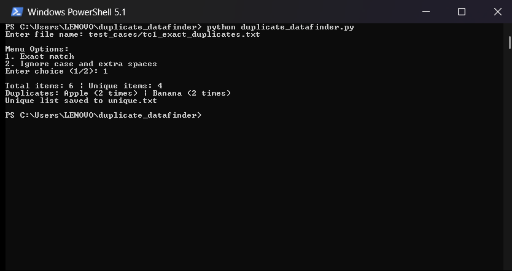
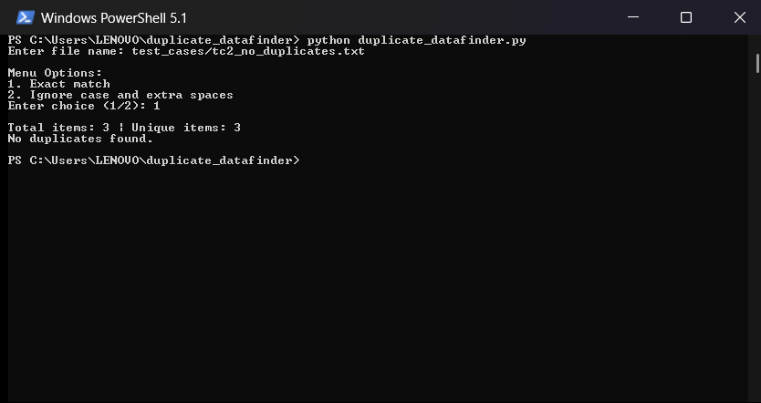
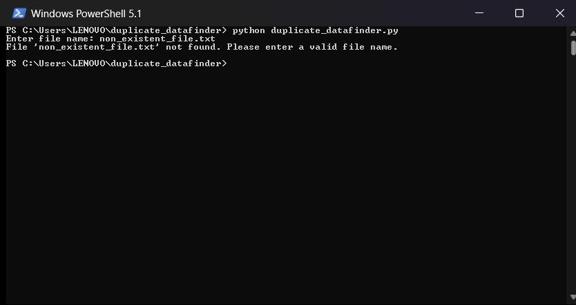
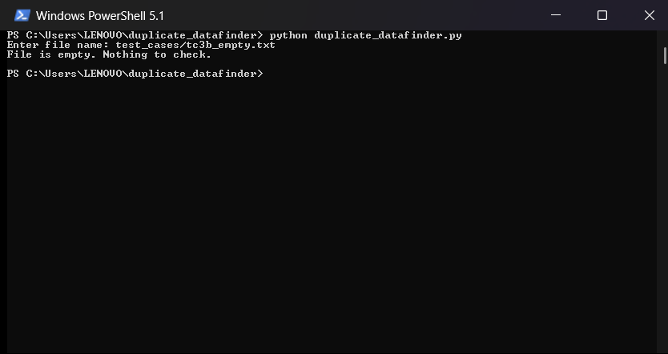
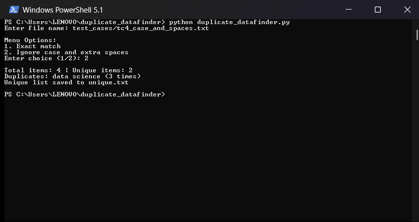
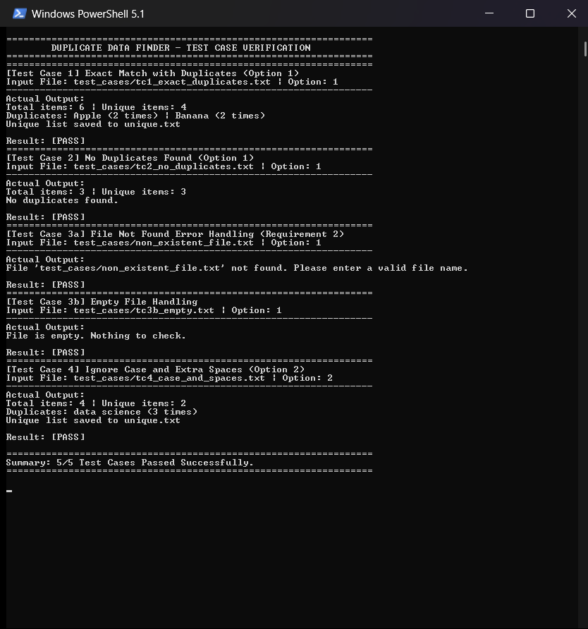

# Summary: Duplicate Data Finder

This document details the implementation of `duplicate_datafinder.py`, requirements coverage, and verification results with individual console screenshots for each test case.

---

## 1. Implementation Details

The program is implemented in `duplicate_datafinder.py` inside the function `find_duplicats()`.

- **Requirement 1 (File Input)**: Prompts user for a file name. Defaults to `data.txt` if input is empty or omitted.
- **Requirement 2 (Exception Handling)**: Reads file inside a `try-except FileNotFoundError` block. Prints `File '<file_name>' not found. Please enter a valid file name.` if missing. Also checks for empty or whitespace-only files and prints `File is empty. Nothing to check.`.
- **Requirement 3 (Unique Set & Count Loop)**:
  - Uses `set(entries)` to determine uniqueness.
  - Preserves original order of appearance by collecting unique items in sequence.
  - Uses an explicit loop to count item frequencies.
- **Requirement 4 (Menu Options)**:
  - Option `1`: Exact match (case and spacing preserved).
  - Option `2`: Normalizes entries by collapsing whitespace (`" ".join(line.split())`) and converting to lowercase (`.lower()`).
- **Requirement 5 (Results Display & Output)**:
  - Prints total and unique item counts.
  - Lists duplicate entries with exact counts.
  - If no duplicates exist, prints `No duplicates found.` (Test Case 2).
  - Saves unique items to the output file (`unique.txt` by default).

---

## 2. Test Case Verification & Screenshots

### Test Case 1: Exact Match with Duplicates (Option 1)
- **Input File:** `test_cases/tc1_exact_duplicates.txt`
- **Option:** 1 (Exact match)
- **Status:** PASS

---

### Test Case 2: No Duplicates Found (Option 1)
- **Input File:** `test_cases/tc2_no_duplicates.txt`
- **Option:** 1 (Exact match)
- **Status:** PASS

---

### Test Case 3a: File Not Found Handling (Requirement 2)
- **Input File:** `non_existent_file.txt`
- **Option:** 1
- **Status:** PASS

---

### Test Case 3b: Empty File Handling
- **Input File:** `test_cases/tc3b_empty.txt` (0-byte file)
- **Option:** 1
- **Status:** PASS

---

### Test Case 4: Ignore Case and Extra Spaces (Option 2)
- **Input File:** `test_cases/tc4_case_and_spaces.txt`
- **Option:** 2 (Normalized match)
- **Status:** PASS

---

### Full Automated Test Suite Execution

All 5 test cases executed sequentially via `run_tests.py`:

